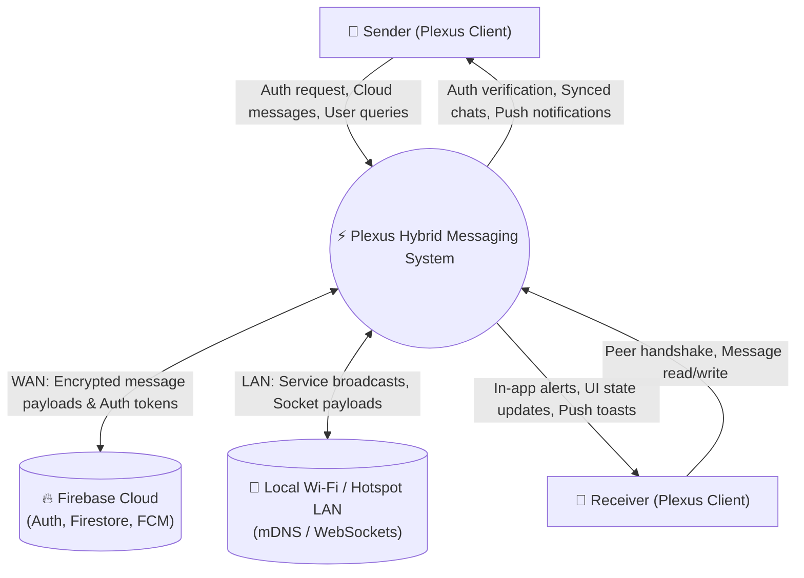
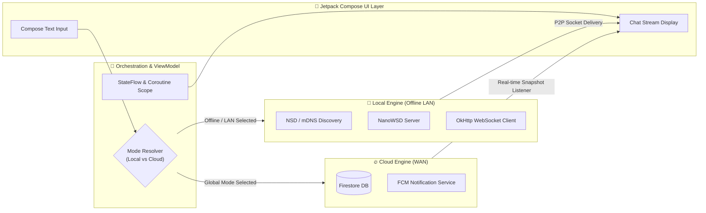
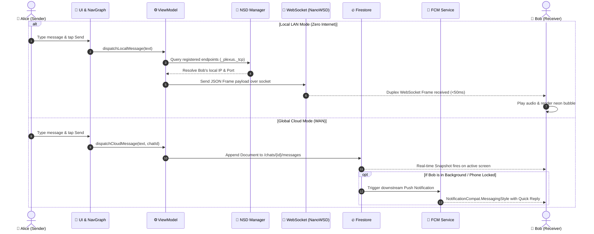

<div align="center">

# ⚡ P L E X U S ⚡
### *Autonomous Hybrid Mesh & Cloud Real-Time Messaging Engine*

[](https://developer.android.com)
[](https://kotlinlang.org)
[](https://developer.android.com/jetpack/compose)
[](https://firebase.google.com)
[](LICENSE)

<br/>

> **"Zero Infrastructure, Zero Internet, Zero Compromise."**  
> Plexus is an offline-first, dual-engine messaging protocol for Android designed for mission-critical communication during internet outages, remote expeditions, local LAN environments, or standard cloud connectivity.

[📥 Download Latest APK](https://drive.google.com/file/d/1wUeEcyu4OCz-8iWTlLKPyyDTbJiwaJr9/view?usp=drivesdk) • [🚀 Architecture](#-system-architecture) • [📊 Data Flow (DFD)](#-data-flow-diagrams-dfd) • [⚡ Tech Stack](#-tech-stack--libraries)

---

</div>

## 🌌 Overview

Most messaging apps fail the moment internet connectivity drops. **Plexus solves this fundamental resilience flaw** by implementing a dynamic routing protocol that multiplexes communication between **local peer-to-peer ad-hoc local network connections** and **global cloud backends**:

```
                       ┌───────────────────────────┐
                       │   PLEXUS ROUTING ENGINE   │
                       └─────────────┬─────────────┘
                                     │
           ┌─────────────────────────┴─────────────────────────┐
           ▼                                                   ▼
 🛰️  [ INTERNET MODE ]                                📡  [ LOCAL MESH MODE ]
  • Cloud Firestore Sync                              • Zero-Config NSD (mDNS)
  • Firebase Phone Auth (OTP)                         • NanoWSD Embedded Server
  • FCM Priority Push Notifications                   • Full-Duplex WebSockets
  • Global Range                                      • Zero Internet Required (<100ms Latency)
```

---

## 📊 Data Flow Diagrams (DFD)

### 🔹 DFD Level 0 — Context Diagram



---

### 🔹 DFD Level 1 — High-Level Functional Decomposition



---

### 🔹 DFD Level 2 — Detailed Message Transmission & Reception



---

## 🚀 Key Features

| Feature | Description | Engine |
| :--- | :--- | :--- |
| **🌐 Dual-Mode Switch** | Seamlessly toggle between Local LAN mode and Global Cloud mode without losing context. | Architecture |
| **📡 Zero-Config P2P** | Discovers nearby devices automatically over Wi-Fi/Hotspot using mDNS (DNS-SD). | Android NSD |
| **⚡ Microsecond Sockets** | Direct, low-latency device-to-device communications via embedded server. | NanoWSD + OkHttp |
| **💬 Smart User Discovery**| Find friends with `@username` indexing or E.164 phone number queries. | Firestore Index |
| **👥 Hybrid Group Chat** | Create and manage multi-device group conversations across both network modes. | StateFlow Engine |
| **🔔 WhatsApp-Grade Alerts** | `MessagingStyle` push notifications with inline direct quick replies (`RemoteInput`). | FCM Service |
| **🎨 Cyberpunk Neon UI** | 100% Jetpack Compose with custom neon gradients, fluid animations, and dark themes. | Material 3 |

---

## 🛠 Tech Stack & Libraries

```text
Language              ▶ Kotlin 2.0+ (100% Coroutines & Flow)
User Interface        ▶ Jetpack Compose (Material 3 BOM 2024), Compose Navigation
Reactive State        ▶ Unidirectional Data Flow (UDF), ViewModel, StateFlow
P2P Networking        ▶ Android NSD (Network Service Discovery), NanoWSD, OkHttp 4.12
Cloud Infrastructure  ▶ Firebase Auth (OTP), Cloud Firestore, Firebase Cloud Messaging
Packaging & Build     ▶ Gradle 8.13, AGP 8.x, Compile SDK 36 (Java 21 Adoption)
```

---

## 📂 Project Architecture

```
app/src/main/java/com/example/plexus/
├── 🌐 data/
│   ├── local/              # P2P: NSD discovery service, NanoWSD server, OkHttp client
│   └── model/              # Data schemas: UserModel, ChatModel, MessageModel, LocalMessageModel
├── 🧭 navigation/          # Compose NavHost, Screen sealed classes, and deep-link routes
├── 🎨 ui/
│   ├── components/         # Reusable Neon Buttons, Glow TextFields, Message Bubbles
│   ├── screens/            # Screens: Splash, Auth, OTP, Home, Chat, LocalDevices, Groups
│   └── theme/              # Cyberpunk palette (Neon Cyan, Electric Purple, Dark Surface)
├── 🛠 utils/               # Time formatters & PlexusMessagingService (MessagingStyle FCM)
└── 🧠 viewmodel/           # Business logic: AuthViewModel, ChatViewModel, LocalChatViewModel
```

---

## 💻 Quick Start & Build

### Prerequisites
- Android Studio Ladybug (2024.2+) or newer
- JDK 21 (Adoptium Temurin recommended)
- Android SDK 34+ (Target SDK 36, Min SDK 24)

### Clone & Compile
```bash
# Clone the repository
git clone https://github.com/varunjoshi84/Plexus.git

# Enter project root
cd Plexus

# Compile Debug APK
./gradlew assembleDebug
```

> Output APK will be generated at: `app/build/outputs/apk/debug/app-debug.apk`

---

## 📥 Download Demo APK

<div align="center">

[](https://drive.google.com/file/d/1wUeEcyu4OCz-8iWTlLKPyyDTbJiwaJr9/view?usp=drivesdk)

*Ready to install and test on physical devices.*

</div>

---

## 📄 License

Distributed under the **Apache License 2.0**. See `LICENSE` for more information.

<div align="center">
<sub>Crafted with ⚡ and Kotlin by Varun Joshi</sub>
</div>
